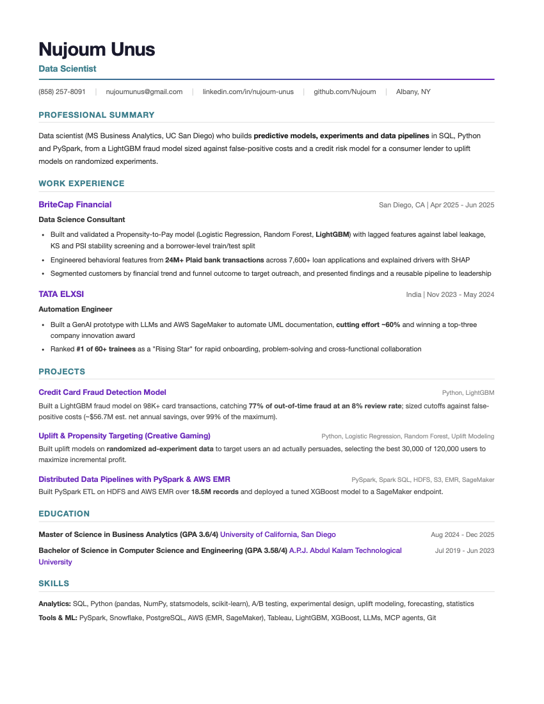

```{=html}
<div class="home">

<section class="stage" aria-labelledby="hero-name">
  <div class="stage-photo">
    
  </div>

  <div class="stage-read">
    <nav class="home-nav" aria-label="Main">
      <a href="#projects">Projects</a>
      <a href="#about">About</a>
      <a href="resume.html">Resume</a>
      <a class="btn" href="mailto:nujoumunus@gmail.com?subject=Hello%20Nujoum">Email me</a>
    </nav>

    <div class="hero-copy reveal">
      <p class="hero-line">Data scientist. I build models and analyses that turn messy data into decisions people can act on.</p>
    </div>

    <h1 id="hero-name" class="wordmark" data-scale-wordmark>nujoum unus</h1>

  </div>
</section>

<section id="about" class="about" aria-labelledby="about-title">
  <div class="wrap about-grid">
    <div class="about-text">
      <h2 id="about-title" class="reveal">About me</h2>
      <p class="reveal">I recently finished my MS in Business Analytics at UC San Diego. I like the point where a model has to become a decision: which transactions to review, which borrowers need outreach, which customers an offer actually persuades.</p>
      <p class="reveal">At BriteCap Financial I built a Propensity-to-Pay model from 24M+ bank transactions for a consumer lender. Before my MS, at TATA ELXSI, I built a GenAI prototype that automated UML documentation and won a top-three company innovation award.</p>
      <p class="reveal">I'm open to data science and analytics roles across industries, from risk and finance to product, marketing and operations.</p>
    </div>
    <dl class="facts">
      <div class="fact reveal"><dt>Tools</dt><dd><ul><li>Python, SQL</li><li>PySpark, Snowflake, PostgreSQL</li><li>AWS (EMR, SageMaker)</li><li>Tableau, Excel, Git</li></ul></dd></div>
      <div class="fact reveal"><dt>Methods</dt><dd><ul><li>Machine learning</li><li>Experimentation and A/B testing</li><li>Regression and segmentation</li><li>NLP and LLMs</li></ul></dd></div>
      <div class="fact reveal"><dt>Experience</dt><dd><ul><li><b>BriteCap Financial</b><br>Data Science Consultant, 2025</li><li><b>TATA ELXSI</b><br>Automation Engineer, 2023–2024</li></ul></dd></div>
      <div class="fact reveal"><dt>Education</dt><dd><ul><li><b>UC San Diego</b><br>MS Business Analytics, 2025</li><li><b>APJ Abdul Kalam Technological University</b><br>B.Tech Computer Science, 2023</li></ul></dd></div>
    </dl>
  </div>
</section>

<section id="projects" class="projects" aria-labelledby="projects-title">
  <div class="wrap">
  <h2 id="projects-title" class="projects-heading">Selected projects</h2>

  <article class="proj">
    <figure class="proj-pic reveal"></figure>
    <div class="proj-text reveal">
      <h3>Card Fraud Detection</h3>
      <p><strong>Problem.</strong> 98,393 government card transactions, 2.53% fraud: how many purchases should be blocked for review?</p>
      <p><strong>Approach.</strong> About 4,400 behavioral features, KS and wrapper selection, and a LightGBM model compared against four others.</p>
      <p><strong>Result.</strong> Catches 77% of out-of-time fraud at an 8% review rate. I recommended a 5 to 5.5% cutoff to limit false alarms on real customers.</p>

      <div class="dial" data-dial>
        <label for="cut" class="dial-label">Try it: review the riskiest <output id="cut-out" for="cut">8</output>%</label>
        <input id="cut" type="range" min="6" max="15" step="1" value="8" aria-describedby="dial-note">
        <dl class="dial-figures">
          <div><dt>Fraud savings</dt><dd><span data-v="fraud">$65.5M</span><b class="bar" data-bar="fraud" style="--w:89%"></b></dd></div>
          <div><dt>False-positive loss</dt><dd><span data-v="fp">$8.9M</span><b class="bar bar-loss" data-bar="fp" style="--w:12%"></b></dd></div>
          <div><dt>Net savings</dt><dd><span data-v="net" class="net">$56.7M</span><b class="bar bar-net" data-bar="net" style="--w:77%"></b></dd></div>
        </dl>
        <p id="dial-note" class="dial-note" data-note>Over 99% of the maximum net savings.</p>
      </div>
      <p class="proj-meta">Python · LightGBM · <a href="projects/featured/card-fraud/index.html">Read the case study</a></p>
    </div>
  </article>

  <article class="proj proj-figures">
    <div class="proj-pic proj-numbers" aria-hidden="true">
      <p><span>24M+</span> bank transactions</p>
      <p><span>7,600+</span> loan applications</p>
    </div>
    <div class="proj-text reveal">
      <h3>Propensity to Pay</h3>
      <p><strong>Problem.</strong> BriteCap Financial, a consumer lender, wanted to know which borrowers were likely to repay.</p>
      <p><strong>Approach.</strong> Behavioral features from Plaid bank data, lagged to avoid label leakage, with KS and PSI stability checks; Logistic Regression, Random Forest and LightGBM compared.</p>
      <p><strong>Result.</strong> A documented, reusable scoring pipeline and a borrower segmentation for collections and remarketing, presented to company leadership.</p>
      <p class="proj-meta">Python · LightGBM · SHAP · UC San Diego capstone, 2025</p>
    </div>
  </article>

  <article class="proj">
    <figure class="proj-pic reveal"></figure>
    <div class="proj-text reveal">
      <h3>Customer Segmentation</h3>
      <p><strong>Problem.</strong> Find natural customer groups and what drives satisfaction.</p>
      <p><strong>Approach.</strong> K-means written from scratch and checked against scikit-learn, K chosen by WCSS and silhouette, and key drivers ranked with eight importance measures including Shapley values.</p>
      <p><strong>Result.</strong> Validated clusters and a ranked list of satisfaction drivers.</p>
      <p class="proj-meta">Python · scikit-learn · XGBoost · <a href="projects/k_means_clustering.html">View project</a></p>
    </div>
  </article>

  <article class="proj">
    <figure class="proj-pic reveal"></figure>
    <div class="proj-text reveal">
      <h3>Matching-Grant Experiment</h3>
      <p><strong>Problem.</strong> Replicate a 50,000-person field experiment on fundraising letters (Karlan and List, 2007).</p>
      <p><strong>Approach.</strong> Randomization checks, t-tests, OLS, probit and simulation in Python.</p>
      <p><strong>Result.</strong> Reproduced the published finding: matching-grant letters lifted response from 1.79% to 2.21% (p = 0.002).</p>
      <p class="proj-meta">Python · statsmodels · <a href="projects/karlan_list_2007_replication.html">View project</a></p>
    </div>
  </article>

  <article class="proj">
    <figure class="proj-pic reveal"></figure>
    <div class="proj-text reveal">
      <h3>Testing a Patent Claim</h3>
      <p><strong>Problem.</strong> A software vendor claimed its customers earn more patents. Is that true?</p>
      <p><strong>Approach.</strong> A hand-coded Poisson regression on 1,500 engineering firms, checked against statsmodels, controlling for region and firm age.</p>
      <p><strong>Result.</strong> Customers earn about 23% more patents, with a clear caveat that the data is observational, not causal.</p>
      <p class="proj-meta">Python · statsmodels · <a href="projects/poisson_regression_examples.html">View project</a></p>
    </div>
  </article>

  <p class="projects-all"><a href="projects.html">All projects <span aria-hidden="true">→</span></a></p>
</div>
</section>

<section id="resume" class="resume-band" aria-labelledby="resume-title">
 <div class="wrap resume-grid">
  <div class="resume-text">
    <h2 id="resume-title" class="reveal">Resume</h2>
    <p class="reveal">Experience, projects, education and skills on one page.</p>
    <p class="resume-actions reveal"><a class="btn" href="resume.html">View resume</a> <a href="resume/Nujoum_Unus_Resume.pdf" download>Download PDF</a></p>
  </div>
  <a class="resume-preview reveal" href="resume.html"></a>
 </div>
</section>

<section id="contact" class="contact" aria-labelledby="contact-title">
  <h2 id="contact-title" class="contact-lead">Hiring for data science or analytics? Write to me.</h2>
  <a class="contact-mail" href="mailto:nujoumunus@gmail.com?subject=Hello%20Nujoum">nujoumunus<wbr>@gmail.com</a>
  <div class="contact-foot">
    <p>Albany, NY</p>
    <p><a href="https://www.linkedin.com/in/nujoum-unus/">LinkedIn</a> <a href="https://github.com/Nujoum">GitHub</a> <a href="resume.html">Resume</a></p>
  </div>
</section>

<footer class="home-foot">
  
  <div class="foot-top">
    <p><a href="#projects">Projects</a> <a href="#about">About</a> <a href="resume.html">Resume</a></p>
    <p><a href="mailto:nujoumunus@gmail.com">nujoumunus@gmail.com</a></p>
  </div>
  <p class="foot-word" aria-hidden="true">nujoum unus</p>
  <p class="foot-legal">© 2026 Nujoum Unus · Photo: “Geisel Library, UC San Diego” by Stephen Bay, CC BY 4.0, via Wikimedia Commons</p>
</footer>

</div>
```
