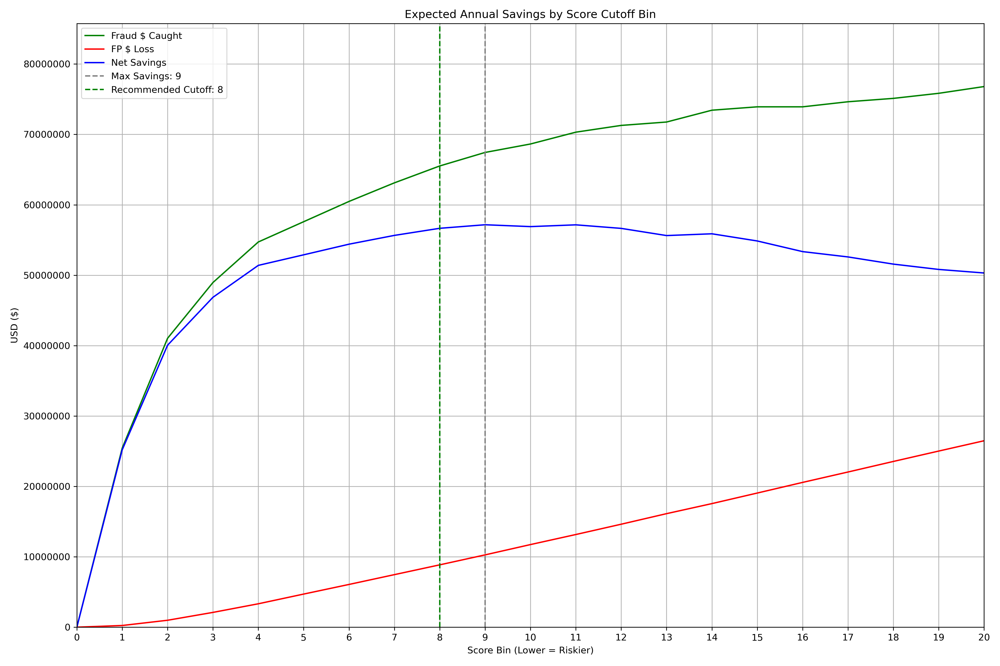
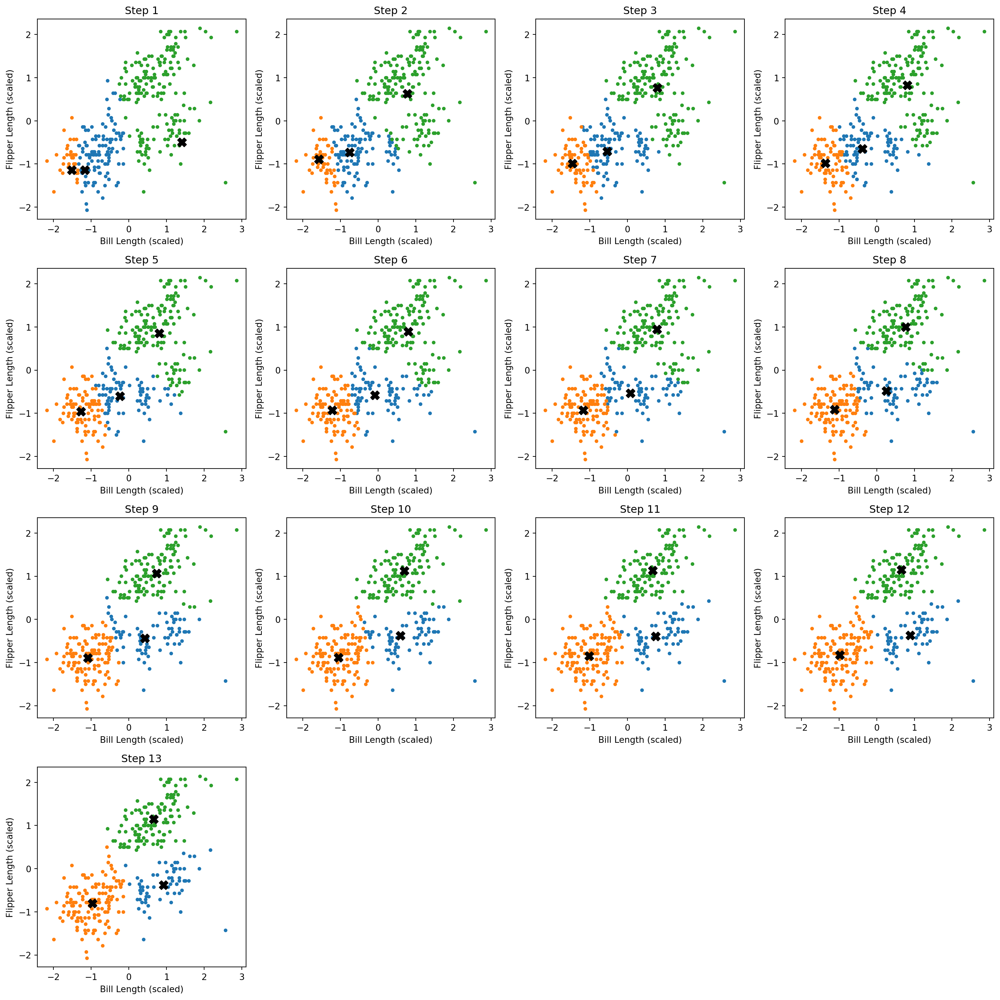
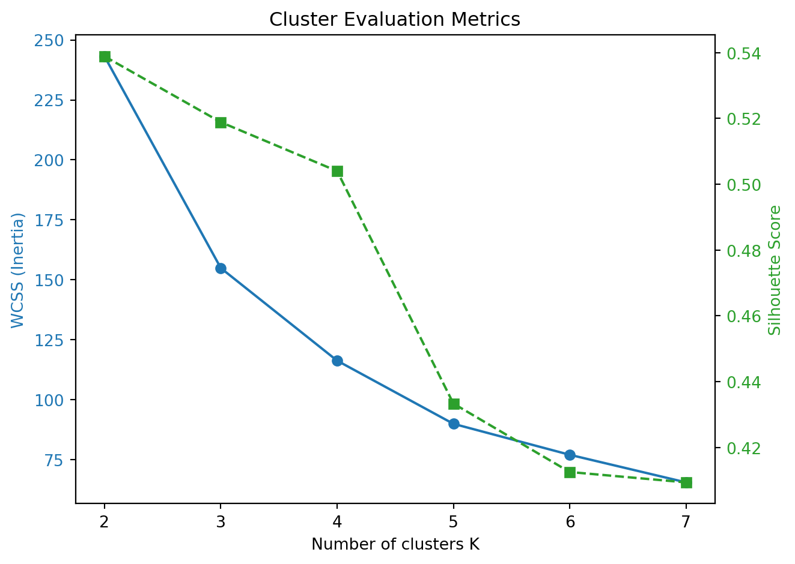
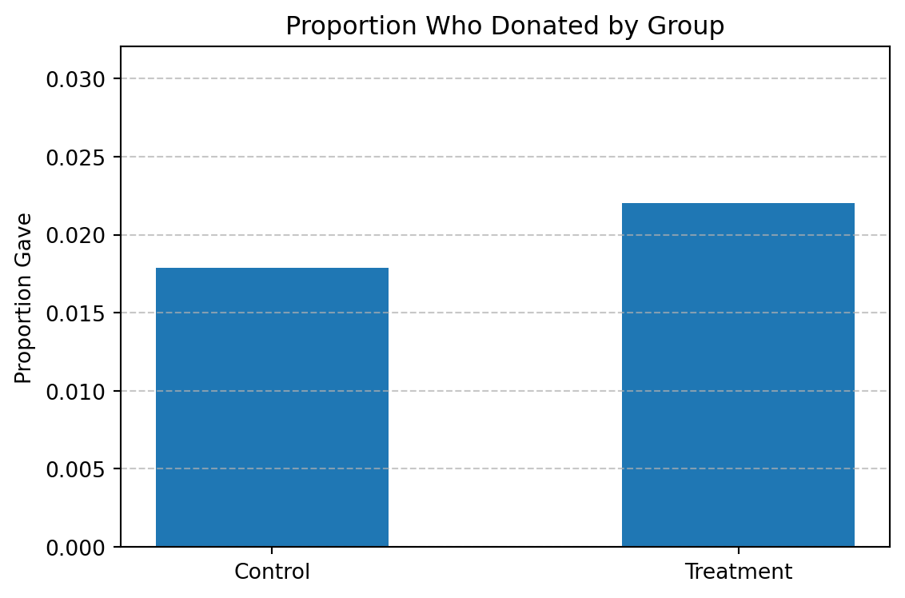
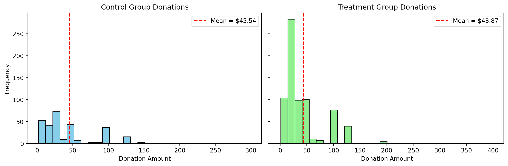
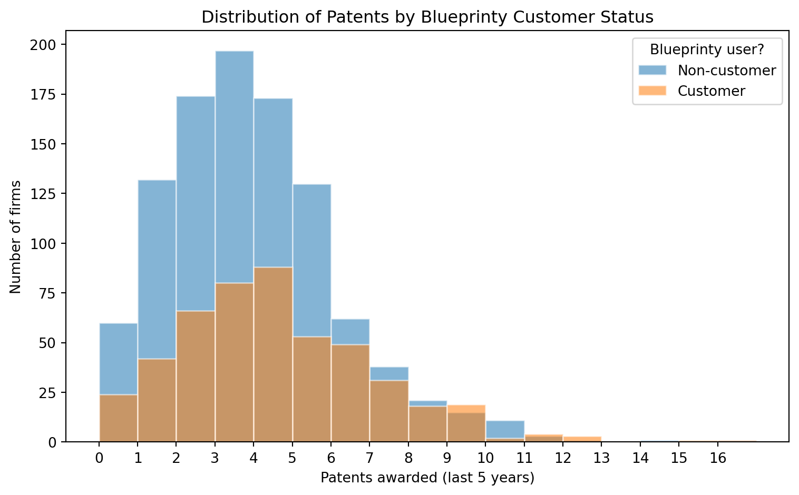
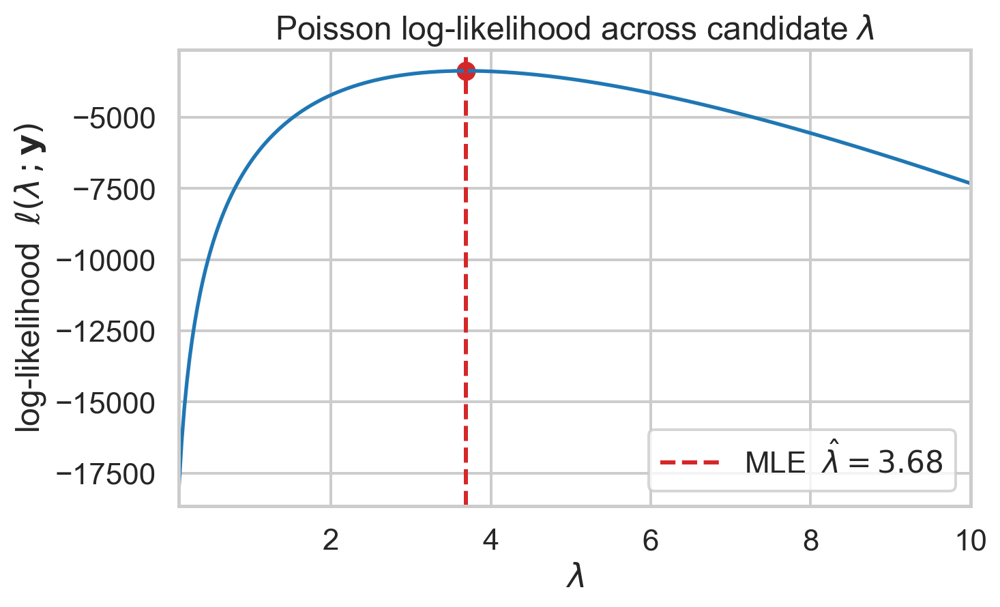

```{=html}
<div class="home">

<section class="stage" aria-labelledby="hero-name">
  <div class="stage-photo">
    
  </div>

  <div class="stage-read">
    <nav class="home-nav" aria-label="Main">
      <a href="#work">Work</a>
      <a href="#cutoff">The cutoff</a>
      <a href="#about">About</a>
      <a href="resume.html">Resume</a>
      <a class="btn" href="mailto:nujoumunus@gmail.com?subject=Hello%20Nujoum">Email me</a>
    </nav>

    <div class="hero-copy reveal">
      <p class="hero-line">Data scientist for fraud, risk and credit. I turn models into decisions.</p>
    </div>

    <h1 id="hero-name" class="wordmark" data-scale-wordmark>nujoum unus</h1>

    <section id="cutoff" class="cutoff" aria-labelledby="cutoff-title">
      <h2 id="cutoff-title" class="reveal">Where I drew the line</h2>
      <p class="reveal">On 98,393 government card transactions, my LightGBM model ranks every purchase by fraud risk. Blocking more of them catches more fraud, but every false alarm stops a real cardholder. Move the cutoff to see the trade-off from my report.</p>

      <div class="dial reveal" data-dial>
        <label for="cut" class="dial-label">Review the riskiest <output id="cut-out" for="cut">8</output>% of transactions</label>
        <input id="cut" type="range" min="6" max="15" step="1" value="8" aria-describedby="dial-note">
        <dl class="dial-figures">
          <div><dt>Fraud savings</dt><dd><span data-v="fraud">$65.5M</span><b class="bar" data-bar="fraud" style="--w:89%"></b></dd></div>
          <div><dt>False-positive loss</dt><dd><span data-v="fp">$8.9M</span><b class="bar bar-loss" data-bar="fp" style="--w:12%"></b></dd></div>
          <div><dt>Net savings</dt><dd><span data-v="net" class="net">$56.7M</span><b class="bar bar-net" data-bar="net" style="--w:77%"></b></dd></div>
        </dl>
        <p id="dial-note" class="dial-note" data-note>An 8% cutoff earns over 99% of the maximum net savings.</p>
      </div>

      <noscript>
        <table>
          <thead><tr><th scope="col">Cutoff</th><th scope="col">Fraud savings</th><th scope="col">False-positive loss</th><th scope="col">Net savings</th></tr></thead>
          <tbody>
            <tr><td>6%</td><td>$60.5M</td><td>$6.1M</td><td>$54.4M</td></tr>
            <tr><td>7%</td><td>$63.1M</td><td>$7.5M</td><td>$55.7M</td></tr>
            <tr><td>8%</td><td>$65.5M</td><td>$8.9M</td><td>$56.7M</td></tr>
            <tr><td>9%</td><td>$67.4M</td><td>$10.3M</td><td>$57.2M</td></tr>
            <tr><td>10%</td><td>$68.6M</td><td>$11.7M</td><td>$56.9M</td></tr>
            <tr><td>11%</td><td>$70.3M</td><td>$13.2M</td><td>$57.2M</td></tr>
            <tr><td>12%</td><td>$71.3M</td><td>$14.6M</td><td>$56.7M</td></tr>
            <tr><td>13%</td><td>$71.8M</td><td>$16.1M</td><td>$55.6M</td></tr>
            <tr><td>14%</td><td>$73.4M</td><td>$17.6M</td><td>$55.9M</td></tr>
            <tr><td>15%</td><td>$73.9M</td><td>$19.1M</td><td>$54.9M</td></tr>
          </tbody>
        </table>
      </noscript>
      <p class="reveal">Net savings peak at 9%. I recommended <strong>5 to 5.5%</strong>: close to the financial optimum, before false alarms on real customers start climbing. <a href="projects/featured/card-fraud/index.html">Read the case study</a></p>

    </section>
  </div>
</section>

<section id="work" class="work" aria-labelledby="work-title">
  <h2 id="work-title" class="work-heading">Selected work</h2>

  <article class="tear" data-tear>
    <div class="tear-stage">
      <figure class="pane pane-l"></figure>
      <figure class="pane pane-r"></figure>
      <div class="tear-copy">
        <h3 class="tear-title">Fraud cutoff</h3>
        <p>Credit card fraud model · 2025 · <a href="projects/featured/card-fraud/index.html">Case study <span aria-hidden="true">→</span></a></p>
      </div>
    </div>
  </article>

  <article class="tear" data-tear>
    <div class="tear-stage">
      <figure class="pane pane-l"></figure>
      <figure class="pane pane-r"></figure>
      <div class="tear-copy">
        <h3 class="tear-title">Segments</h3>
        <p>K-means and key drivers · 2025 · <a href="projects/k_means_clustering.html">Project <span aria-hidden="true">→</span></a></p>
      </div>
    </div>
  </article>

  <article class="tear" data-tear>
    <div class="tear-stage">
      <figure class="pane pane-l"></figure>
      <figure class="pane pane-r"></figure>
      <div class="tear-copy">
        <h3 class="tear-title">Matching</h3>
        <p>Matching-gift field experiment · 2025 · <a href="projects/karlan_list_2007_replication.html">Project <span aria-hidden="true">→</span></a></p>
      </div>
    </div>
  </article>

  <article class="tear" data-tear>
    <div class="tear-stage">
      <figure class="pane pane-l"></figure>
      <figure class="pane pane-r"></figure>
      <div class="tear-copy">
        <h3 class="tear-title">Patents</h3>
        <p>Poisson regression · 2025 · <a href="projects/poisson_regression_examples.html">Project <span aria-hidden="true">→</span></a></p>
      </div>
    </div>
  </article>

  <p class="work-all"><a href="projects.html">All projects <span aria-hidden="true">→</span></a></p>
</section>

<section id="about" class="letter" aria-labelledby="about-title">
  <div class="sheet">
    
    <h2 id="about-title">About me</h2>
    <p class="reveal">I'm a data scientist who likes the moment a model has to become a decision. Where should the fraud cutoff sit? Which borrowers need a call this week? What does a false alarm actually cost?</p>
    <p class="reveal">At BriteCap Financial, a consumer lender, I built a Propensity-to-Pay model from 24M+ bank transactions across 7,600+ loan applications, guarded it against label leakage, and handed leadership a reusable scoring pipeline.</p>
    <p class="reveal">In my MS Business Analytics at UC San Diego I built fraud models for card transactions and synthetic identities, and PySpark pipelines on AWS EMR over 18.5M records.</p>
    <p class="reveal">Before that, at TATA ELXSI, I built a GenAI prototype that automated UML documentation and won a top-three company innovation award.</p>
    <p class="reveal">I'm looking for <mark>fraud, risk and credit analytics roles</mark> where the numbers decide something real.</p>
    <p class="sign">Nujoum Unus</p>
    <p class="sign-role">Data scientist · Albany, NY</p>
  </div>
</section>

<section id="contact" class="contact" aria-labelledby="contact-title">
  <h2 id="contact-title" class="contact-lead">Hiring for fraud, risk or credit analytics? Write to me.</h2>
  <a class="contact-mail" href="mailto:nujoumunus@gmail.com?subject=Hello%20Nujoum">nujoumunus<wbr>@gmail.com</a>
  <div class="contact-foot">
    <p>Albany, NY</p>
    <p><a href="https://www.linkedin.com/in/nujoum-unus/">LinkedIn</a> <a href="https://github.com/Nujoum">GitHub</a> <a href="resume.html">Resume</a></p>
  </div>
</section>

<footer class="home-foot">
  
  <div class="foot-top">
    <p><a href="#work">Work</a> <a href="projects.html">Projects</a> <a href="resume.html">Resume</a></p>
    <p><a href="mailto:nujoumunus@gmail.com">nujoumunus@gmail.com</a></p>
  </div>
  <p class="foot-word" aria-hidden="true">nujoum unus</p>
  <p class="foot-legal">© 2026 Nujoum Unus · Photo: “Geisel Library, UC San Diego” by Stephen Bay, CC BY 4.0, via Wikimedia Commons</p>
</footer>

</div>
```
