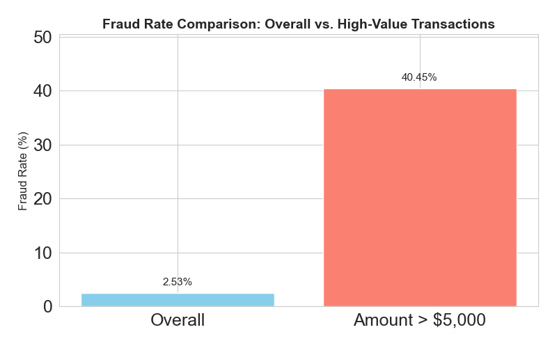

## The problem

A U.S. government program's credit cards logged **98,393 transactions in 2010**. Only **2.53%** were fraud. The question wasn't just "can we score fraud?" It was **how many transactions to block**, because every false alarm stops a legitimate purchase.

## What I built

**Data quality.** I excluded non-purchase records, fixed malformed merchant state codes, filled missing ZIPs and states, and removed a single $3.1M record that would have distorted scaling.

**Features.** About **4,400 candidate variables** capturing behavior over time:

| Group | Example | Why it matters |
|---|---|---|
| Transaction counts | Card activity over 0 to 60 day windows | Fraudsters concentrate purchases in short bursts |
| Amount ratios | Today's amount vs. the card's average and max | Normalizes cards with different spending levels |
| Velocity change | Short-term vs. long-term activity | Catches sudden spikes |
| Entity links | Card + merchant, card + ZIP pairs | Pairs that are risky together but normal alone |
| Days since | Time since a card or merchant was last active | Fraud often follows dormancy |

{width=75%}

**Selection and model.** I filtered features with a KS test, ran wrapper selection down to a compact set, and compared decision trees, random forests, LightGBM, LightGBM with SMOTE and a neural network. **LightGBM (GOSS)** held up best from train to out-of-time data.

## Results

Fraud detection rate at a 3% review rate (FDR@3%):

| Train | Test | Out-of-time |
|---|---|---|
| 0.84 | 0.77 | **0.60** |

Reviewing the top **8%** of scores catches **77% of out-of-time fraud**.

## The decision: where to set the cutoff

| Cutoff | Fraud savings | False-positive loss | Net savings |
|---|---|---|---|
| 6% | $60.5M | $6.1M | $54.4M |
| 8% | $65.5M | $8.9M | **$56.7M** |
| 9% | $67.4M | $10.3M | $57.2M (max) |
| 12% | $71.3M | $14.6M | $56.7M |

An 8% cutoff earns **over 99% of the maximum net savings** while cutting about $1.4M of false-positive cost versus the maximum.

But money isn't the only cost. Past roughly 5 to 6%, false positives start climbing fast, and each one is a real cardholder whose purchase gets blocked. **I recommended a 5 to 5.5% cutoff**: close to the financial optimum, before the point where customer friction escalates.

## What I'd do next in production

- Monitor score drift and fraud rates monthly, since fraud patterns shift
- Champion/challenger test any new cutoff before rolling it out
- Add reason codes so reviewers see why a transaction was flagged

[Code on GitHub](https://github.com/Nujoum/Credit-Card-Fraud)
